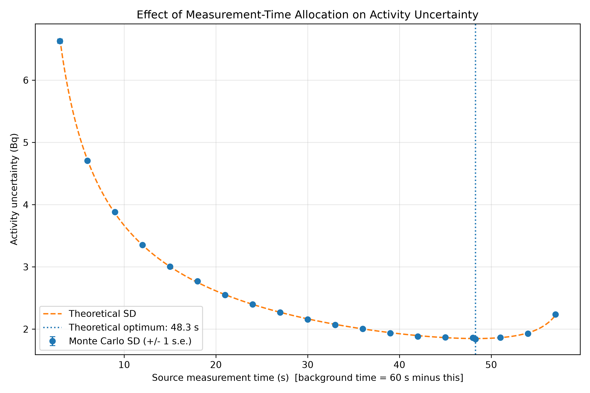

# Radioactive Decay and Detector Counting Simulator

A Python-based computational nuclear physics project exploring radioactive decay, Monte Carlo simulation, radiation-counting statistics, detector efficiency, background radiation, and measurement uncertainty.

## Research objective

The project investigates how counting duration, background count rate, and measurement-time allocation affect the estimation of radioactive source activity in a simulated counting system.

**Central research question:** How do background radiation and counting-time decisions affect the uncertainty and reliability of estimated source activity?

## Research modules

- **Radioactive decay:** Analytical calculations of remaining nuclei, half-life, and activity.
- **Monte Carlo simulation:** Stochastic modelling of radioactive decay and comparison with analytical predictions.
- **Detector model:** Estimation of source activity using gross counts, background counts, measurement durations, and detection efficiency.
- **Counting-time study:** Investigation of how measurement duration affects uncertainty.
- **Background-rate study:** Comparison of measurement uncertainty under different background conditions.
- **Measurement-time optimization:** Investigation of how a fixed measurement duration is best divided between source-plus-background and background-only measurements.

## Mathematical model

For a source activity $A$, detection efficiency $\varepsilon$, background count rate $r_b$, source measurement time $T_s$, and background measurement time $T_b$, the gross and background counts are independent Poisson variables:

$$G \sim \mathrm{Poisson}\left[(\varepsilon A + r_b)\,T_s\right], \qquad B \sim \mathrm{Poisson}(r_b T_b)$$

The estimated source activity is

$$\hat{A} = \frac{1}{\varepsilon}\left(\frac{G}{T_s} - \frac{B}{T_b}\right)$$

This estimator is unbiased, $E[\hat{A}] = A$, with theoretical variance

$$\mathrm{Var}(\hat{A}) = \frac{1}{\varepsilon^{2}}\left(\frac{\varepsilon A + r_b}{T_s} + \frac{r_b}{T_b}\right)$$

The standard uncertainty reported for a single measurement replaces the expected counts with the observed counts:

$$u(\hat{A}) = \frac{1}{\varepsilon}\sqrt{\frac{G}{T_s^{2}} + \frac{B}{T_b^{2}}}$$

For a fixed total time $T_s + T_b$, minimising the variance gives the optimal time split:

$$\frac{T_b}{T_s} = \sqrt{\frac{r_b}{\varepsilon A + r_b}}$$

The model assumes independent Poisson counts, constant source and background rates, known detection efficiency, and negligible dead-time losses.

## Simulation findings

Using a simulated source activity of 100 Bq and a detection efficiency of 0.80, with 2,000 Monte Carlo trials per condition for the first two studies:

| Study | Condition | Monte Carlo SD | Theory SD |
|---|---|---|---|
| Counting time | 1 s, $r_b$ = 5 /s | 12.014 Bq | 11.86 Bq |
| Counting time | 60 s, $r_b$ = 5 /s | 1.530 Bq | 1.531 Bq |
| Background rate | 60 s, $r_b$ = 1 /s | 1.432 Bq | 1.461 Bq |
| Background rate | 60 s, $r_b$ = 20 /s | 1.792 Bq | 1.768 Bq |

- Increasing counting duration from 1 to 60 seconds reduced the standard deviation of estimated activity by about 87%.
- Raising the background rate from 1 to 20 counts/s increased the standard deviation at 60 s by roughly 21% in theory (25% observed; the difference is within the sampling uncertainty of a 2,000-trial simulation).
- For a fixed total of 60 s and a background rate of 5 counts/s, the optimal split is about **48.3 s on the source and 11.7 s on background** (19.5% of the time on background). This gives an uncertainty of 1.849 Bq, **14.6% lower than an equal split** (2.165 Bq). The Monte Carlo minimum (20,000 trials per point) falls at the same fraction as the theoretical optimum.



Because the estimator is linear in Poisson counts, it is unbiased by construction, so these studies test **precision**, not bias. The mean estimates match the true 100 Bq within statistical error.

These are computational results under stated assumptions, not experimental measurements from a physical detector.

## Technology

- Python
- NumPy
- Matplotlib
- pytest
- Git and GitHub

## Project structure

```text
Radioactive-Decay-Simulator/
├── src/
│   ├── decay_physics.py
│   ├── monte_carlo.py
│   └── detector_model.py
├── scripts/
│   ├── radioactive_decay.py
│   ├── compare_decay.py
│   ├── monte_carlo_study.py
│   ├── detector_uncertainty_study.py
│   ├── background_rate_study.py
│   └── measurement_time_optimization.py
├── tests/
│   ├── test_decay_physics.py
│   ├── test_monte_carlo.py
│   └── test_detector_model.py
├── results/
├── requirements.txt
├── LICENSE
├── SECURITY.md
├── .gitignore
└── README.md
## Setup

Clone the repository and enter the project directory:

```bash
git clone https://github.com/mevian18/Radioactive-Decay-Simulator.git
cd Radioactive-Decay-Simulator
```

Create and activate a virtual environment.

Windows (PowerShell):

```powershell
python -m venv .venv
.\.venv\Scripts\Activate.ps1
```

macOS / Linux:

```bash
python3 -m venv .venv
source .venv/bin/activate
```

Install the dependencies:

```bash
pip install -r requirements.txt
```

## Running the simulations

Run each experiment from the project root as a module (the scripts import from `src/`, so use `python -m`, not `python scripts/name.py`):

```bash
python -m scripts.compare_decay
python -m scripts.monte_carlo_study
python -m scripts.detector_uncertainty_study
python -m scripts.background_rate_study
python -m scripts.measurement_time_optimization
```

Generated plots are saved in the `results/` directory.

## Running the tests

From the project root:

```bash
python -m pytest tests
```

The test suite includes a check that the Monte Carlo estimator is unbiased, that its empirical standard deviation matches the theoretical value, and that the reported uncertainty has the expected coverage (about 68% within one standard deviation).

## Limitations and future work

- The detector model is purely statistical: constant rates, known efficiency, no dead time, no energy dependence.
- The reported uncertainty $u(\hat{A})$ is unreliable at very low counts (below roughly 10) and equals zero when both counts are zero. Estimates are deliberately not clipped at zero, so they remain unbiased but can be negative at low counts.
- The optimal time split depends on the true activity, which is unknown in practice; a short preliminary measurement would be needed to apply it.
- Future work: the low-count regime and detection limits (Currie critical level and minimum detectable activity), sensitivity analysis across source activities and efficiencies, dead-time effects, and comparison with experimental counting data where suitable equipment is available.

## Research integrity

All findings are generated from simulations under explicitly stated assumptions and should not be interpreted as experimental validation of a physical radiation detector. The estimator and its variance are standard counting-statistics results; this project's contribution is a reproducible Monte Carlo validation and a quantitative study of time allocation.

## License

Released under the MIT License. See [LICENSE](LICENSE).

## Author

[mevian18]